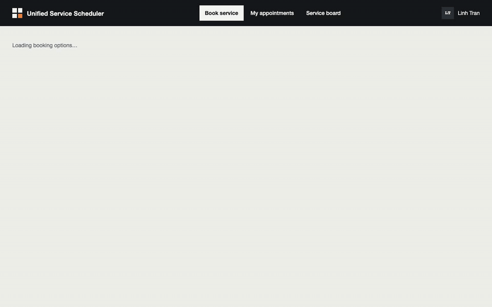

# Unified Service Scheduler

[](https://github.com/DuckHweeee/service-scheduler/actions/workflows/ci.yml)

## The problem, in plain terms

A dealership books a car in for service. That booking is only real if **a service bay** *and* **a technician
qualified for the job** are both free for the **whole time** the job takes — not just at the start. Two advisors
booking the same slot at the same moment must not both succeed. Same-day "express" visits need extra rules: a
minimum lead time, a daily cap, and parts that are actually in stock. And a customer must be able to move an
existing appointment to a new time without losing its history.

This repo is a working answer to that problem: a REST API that makes the booking decision correctly under
concurrency, a Postgres schema that enforces it even if the application code is wrong, and a React UI (built from
the provided design) that drives it. It was built as a Keyloop technical assessment (**Scenario A**), with the
**backend fully implemented and tested**; the web app is a client harness that can run against the real API or
against mocks.



<sub>Recorded from the Docker stack with <a href="scripts/record-demo.mjs"><code>scripts/record-demo.mjs</code></a>.
**Full walkthrough (2.5 min, captioned): [`docs/walkthrough.mp4`](docs/walkthrough.mp4)** — book, a lost race with alternatives,
reschedule, same-day Express, the advisor's service board with check-in, and cancel
(<a href="scripts/record-flow.mjs"><code>scripts/record-flow.mjs</code></a>).</sub>

## See it running — Docker, two commands

```bash
docker compose --profile app up --build
```

Open **http://localhost:5173** for the app, **http://localhost:3000/docs** for the live API contract (Swagger).
That one command builds the images, starts Postgres, runs migrations, seeds demo data, then starts the API and web
app in order. Add the observability stack (Grafana, Prometheus, Jaeger) with:

```bash
docker compose --profile app --profile obs up -d --build   # + Grafana :3001 · Prometheus :9090 · Jaeger :16686
docker compose --profile app --profile obs down            # stop everything (add -v to also drop the DB volume)
```

The seed is deterministic and relative to today: three dealerships (one, `DLR-03`, is deliberately missing an
alignment-qualified technician; another, `DLR-02`, is deliberately out of stock on one part — both exist to make
the conflict/parts screens demonstrable), eight service types, and a demo customer **Linh Tran (`CUS-10482`)** with
two vehicles and ~30% background load over the next ten working days.

A few knobs you'll likely want:

| What | How |
|---|---|
| Pin "now" for a demo (e.g. to show same-day rules at a specific hour) | `CLOCK_OVERRIDE=2026-10-08T09:10:00+07:00 docker compose --profile app up -d` |
| Re-run the seed against a non-empty database | `docker compose --profile app run --rm -e SEED=always migrate` |
| Change a host port (default `API_PORT=3000`, `WEB_PORT=5173`, `PG_PORT=54329`, `GRAFANA_PORT=3001`, `PROMETHEUS_PORT=9090`) | set the env var; if you change `API_PORT`/`WEB_PORT` also set `API_PUBLIC_URL`/`WEB_ORIGIN` so the browser and CORS still agree |

Full detail on tracing, dashboards and the load test: [`docs/observability.md`](docs/observability.md) ·
[`loadtest/README.md`](loadtest/README.md).

### Running it without Docker

If you have Node 22+ and pnpm 10 (`corepack enable`) and would rather not use containers, the database runs from an
embedded PostgreSQL binary instead — no separate service to install:

```bash
pnpm install
pnpm db:up                       # terminal 1 — Postgres 18 on :54329, Ctrl-C stops it
pnpm db:migrate && pnpm db:seed  # terminal 2
pnpm dev:real                    # API :3000 (docs at /docs) · web :5173
```

Other useful commands: `pnpm dev:mock` (web only, against in-browser mocks, no database — try
`?mock=conflict`, `?mock=parts`, `?mock=cutoff`, `?mock=morning`), `pnpm dev` (both, web on mocks unless
`VITE_USE_MOCKS=false`), and the same `CLOCK_OVERRIDE=... pnpm --filter @scheduler/api dev` trick as above. `pnpm
db:up` and the Docker `postgres` service both bind `:54329`, so don't run both at once unless you move one with
`PG_PORT`. Configuration is environment-only — see [`.env.example`](.env.example); defaults work out of the box.

## What's actually proven here

Claims about correctness are worth little without evidence, so here is what was run and where the full output
lives (commands run on commit from 2026-10-12):

| | Result | Source |
|---|---|---|
| Tests | **354** unit + integration (contracts 23 · API unit 83 · API integration 181 on a real PostgreSQL · web 67) and **16** Playwright e2e on the real API, all passing | [quality.md](docs/quality.md#test-counts) |
| Coverage | availability engine **100%** statements / branches / functions / lines (enforced); API overall 94.58% statements, 90.85% branches (floor enforced) | [quality.md](docs/quality.md#coverage) |
| Mutation score | **98.77%** on `src/domain/**` (Stryker: 318 killed, 4 timeout, 3 survived, 1 no coverage — the 4 argued equivalent) | [quality.md](docs/quality.md#mutation-testing) |
| Concurrency | 20 parallel bookings for one free slot → exactly 1×201 and one row, also with the advisory lock removed; 20 parallel reschedules into one window → 1×200 (R11); the same appointment moved to two days at once → one winner (R15b) | [quality.md](docs/quality.md#reschedule-suites-wave-5) · [ADR-002](docs/adr/002-double-booking-prevention.md) · [ADR-006](docs/adr/006-reschedule-in-place.md) |
| Independent review | a lock-order deadlock (reschedule vs cancel / no-show sweeper → `40P01` → 500) missed by the main test suites, found by an adversarial review agent, reproduced and fixed | [ai-log W5-Q2](docs/ai-log.md#wave-5--showcase-polish-2026-10-12) · [quality.md](docs/quality.md#manual-and-adversarial-checks) |
| Load test (k6, one API process) | 772 req/s with 0 failed requests; booking p95 100.9 ms, availability p95 13.0 ms; **0** invariant violations after 1,001 bookings | [performance.md](docs/performance.md) |

| | |
|---|---|
|  |  |
|  |  |
|  |  |

To reproduce any of it yourself:

```bash
pnpm verify              # typecheck + lint + all unit/integration tests — exit code is what CI uses
pnpm --filter @scheduler/api test:unit     # pure engine + time + seed (fast)
pnpm --filter @scheduler/api test:int      # integration tests against a real, ephemeral PostgreSQL
pnpm e2e                 # Playwright: real API + real DB + web (see e2e/README.md)
pnpm coverage            # coverage with thresholds (engine 100%)
pnpm --filter @scheduler/api mutation      # Stryker mutation testing on src/domain/** (~20 s)
```

`pnpm e2e` uses Playwright's bundled Chromium (`pnpm exec playwright install chromium` once); on macOS 12 where
that build doesn't run, point it at an installed Chrome instead:
`PW_CHROME_PATH="/Applications/Google Chrome.app/Contents/MacOS/Google Chrome" pnpm e2e`.

What the suites actually cover:

- **Availability engine** — every rule in the spec's test table (T1–T21: full-duration overlap, back-to-back, skills, bay
  types, assignment preference, same-day lead time/quota/cutoff), plus property-based tests that re-derive every slot
  status independently.
- **Booking under concurrency** — 20 parallel requests for one free slot → exactly one 201 and one row; capacity 2 →
  exactly two; same-day quota races; parts-stock races; concurrent idempotent retries; check-in vs no-show sweeper races.
- **Reschedule** — every SPEC §6.5 case by id (R1–R15, R15b): parts follow the channel, 20 parallel reschedules into
  one window, reschedule vs booking, crossing days without deadlock, the same appointment moved twice at once; plus a
  30-test independent adversarial suite.
- **Database invariants** — exclusion constraints reject overlapping technician / bay / vehicle bookings; composite
  foreign keys stop cross-dealership assignment; inventory can never be over-reserved.
- **API behaviour** — every endpoint and error code (problem+json), audit history wording, metrics.
- **Web** — component tests on mocks; e2e journeys (book → record → cancel; conflict → alternatives; same-day
  express; board check-in; book → reschedule) plus screenshots at 1440 and 390 px.

Integration tests never mock the database: a vitest global setup starts an ephemeral PostgreSQL on a random port
and each test file gets its own database cloned from a migrated template.

## How double booking is actually prevented

The same guarantee is enforced three times, independently, so that a bug in one layer can't cause a double-booking:

1. **The engine decides correctly.** A window is bookable only if some bay of an allowed type **and** some
   technician with the required skill are free for the **whole** half-open interval `[start, end)`.
2. **The transaction re-checks under lock.** Booking takes a PostgreSQL advisory lock for that dealership-day,
   re-reads the schedule inside the transaction, and re-checks before inserting — so the right reason, alternatives
   and same-day quota still hold under contention.
3. **The database refuses to store an overlap, no matter what.** `EXCLUDE USING gist` constraints on
   `(technician_id, during)`, `(service_bay_id, during)` and `(vehicle_id, during)` make an overlap physically
   impossible to insert, even if layers 1 or 2 were wrong — proven by deliberately removing the lock and confirming
   it still never double-books. See [ADR-002](docs/adr/002-double-booking-prevention.md).

Reschedule reuses the same three layers: it locks both the old and new dealership-day in a fixed order (to avoid
deadlock), re-checks the new window as if the appointment were already gone, and writes through a guarded `UPDATE`
that the same database constraints still check. See [ADR-006](docs/adr/006-reschedule-in-place.md) and
[System Design §4.3](docs/SYSTEM_DESIGN.md#43-rescheduling-write-path-adr-006).

## API at a glance

| Method & path | Purpose |
|---|---|
| `GET /api/v1/dealerships/{id}/availability?serviceType&date&vehicleId[&excludeReference]` | Slot grid for a day: status per 30-min start + proposed bay/technician. `excludeReference=APT-…` computes the grid as if that appointment did not exist (reschedule screen); 422 `RESCHEDULE_SCOPE_MISMATCH` if it belongs to another dealership, service or vehicle |
| `POST /api/v1/appointments` (`Idempotency-Key` optional) | Book: 201, or 409 `SLOT_UNAVAILABLE` with `reason` and up to 5 alternatives. Same key + same request replays with 200; same key + different request is 422 `IDEMPOTENCY_KEY_REUSED` |
| `GET /api/v1/appointments/{reference}` | Appointment with customer, vehicle, technician, bay, parts and booking history |
| `GET /api/v1/appointments?customerId` | Customer's appointments |
| `POST /api/v1/appointments/{reference}/cancel` | Cancel and free resources; 409 `APPOINTMENT_NOT_CANCELLABLE` once started or checked in |
| `POST /api/v1/appointments/{reference}/reschedule` | Move to another date/time at the same dealership, in place (same reference): 200, or 409 `SLOT_UNAVAILABLE` (+ alternatives) / `VEHICLE_ALREADY_BOOKED` / `PARTS_UNAVAILABLE` / `APPOINTMENT_NOT_RESCHEDULABLE`, and the booking 422s. Same slot → 200, no change ([ADR-006](docs/adr/006-reschedule-in-place.md)) |
| `POST /api/v1/appointments/{reference}/check-in` | Advisor check-in; late same-day arrivals are released |
| `GET /api/v1/dealerships/{id}/board?date` | Day timeline per bay and technician |
| `GET/PUT /api/v1/dealerships/{id}/inventory[/{sku}]` | Parts stock (stands in for a DMS feed) |
| `GET /api/v1/dealerships`, `/service-types`, `/customers/{id}`, `/customers/{id}/vehicles` | Reference data |

Errors are RFC 7807 `application/problem+json` with a stable `code`; dates must be real calendar dates
(`2026-11-31` is a 400 `VALIDATION_ERROR`). Full contract: `/docs` on the running API, or
[`docs/openapi.yaml`](docs/openapi.yaml). Ready-to-run requests: [`docs/requests.http`](docs/requests.http) ·
[`docs/curl-examples.md`](docs/curl-examples.md).

## Repository layout

```
packages/contracts   zod schemas, enums, URL paths, fixtures — shared by API and web
apps/api             Fastify API: routes → services → pure domain (availability engine, same-day policy, time)
  drizzle/           migrations (incl. hand-written EXCLUDE constraints)
  test/              unit + integration (real PostgreSQL)
  Dockerfile         API image (multi-arch, non-root, healthcheck)
apps/web             React app: Book, My appointments, Appointment record, Reschedule, Service board; MSW mocks
e2e/                 Playwright specs with their own DB/API/web stack
loadtest/            k6 script, load-data seed, SQL invariant check
ops/                 Prometheus config, provisioned Grafana dashboard, migrate/seed entrypoint for compose
design/              the original UI design bundle and the extracted screens
docs/                system design, spec, ADRs, quality + performance evidence, observability, API docs, AI log,
                     agent briefs, screenshots
```

## Everything else, documented

| Topic | Where |
|---|---|
| System design (architecture, data flow, tech choices, observability, GenAI in design) | [`docs/SYSTEM_DESIGN.md`](docs/SYSTEM_DESIGN.md) |
| The full spec / contract, and the reasoning behind each decision | [`docs/SPEC.md`](docs/SPEC.md) · [`docs/adr/`](docs/adr/) |
| Observability: metrics, tracing, the Grafana dashboard | [`docs/observability.md`](docs/observability.md) |
| Quality and performance evidence in full | [`docs/quality.md`](docs/quality.md) · [`docs/performance.md`](docs/performance.md) · [`loadtest/`](loadtest/README.md) |
| How this was built with AI, and what it caught | [below](#ai-collaboration-narrative) · full log [`docs/ai-log.md`](docs/ai-log.md) · agent prompts [`docs/agent-briefs/`](docs/agent-briefs/) |

## Known limitations

- **No authentication.** The web app acts as customer `CUS-10482`; the service board is an unauthenticated advisor view.
- **The browser decides "today."** The web app reads the browser clock in the dealership's timezone to decide what
  "today" means for same-day rules; if you pin the API's clock with `CLOCK_OVERRIDE`, your browser clock needs to
  agree too (the e2e suite pins both). The server's own answers about same-day availability are always correct
  regardless of the browser.
- **Check-in isn't time-bounded.** An advisor can check in an appointment on an earlier day than scheduled — the
  spec doesn't restrict it (§6.3). Reserved parts are released on cancel/no-show but never consumed on completion;
  stock correction is expected to come from the DMS inventory sync, which is out of scope here.
- **The availability grid doesn't flag a vehicle's own conflicts.** It won't mark a slot where the customer's
  vehicle is already booked elsewhere; booking or rescheduling into one instead returns 409
  `VEHICLE_ALREADY_BOOKED` (and the 409's alternatives already skip such slots).
- **Appointment references can theoretically collide at extreme scale.** They're `APT-<date>-<nextval % 10000>`; at
  10,000+ bookings on the same date, two can collide, and the unique constraint rejects the second insert as a 500
  instead of a 409 (only `23P01` is currently mapped). A per-date counter or a longer suffix would remove this.
- **Reschedule stays within the same dealership and service.** Moving to a different dealership or service is a
  cancel plus a new booking. Notifications are out of scope.
- **The Docker image isn't a tuned production build.** The API container runs TypeScript directly through `tsx`
  (no compile step) — simple to build, but not optimized for production. Tracing is head-sampled at 10% by default
  in Compose, because 100% sampling OOM-killed the in-memory Jaeger store under load.

More, including design sketches for authentication and technician shifts: [System Design §10](docs/SYSTEM_DESIGN.md#10-future-work).

---

## AI Collaboration Narrative

> Draft prepared from the project log for Huy to review and edit in their own words before submission.

**Tools.** Claude Code with **Claude Opus** as design partner and orchestrator, and **Claude Sonnet** agents as
implementers, each running in an isolated git worktree. Every prompt given to an agent is archived verbatim in
[`docs/agent-briefs/`](docs/agent-briefs/); every review, defect and correction is dated in [`docs/ai-log.md`](docs/ai-log.md).

### Strategy: make the work well-scoped before any AI writes code

1. **Humans decide, AI frames.** Opus turned the open questions (which layer, stack, scope, timebox) into explicit options with
   a recommendation; I made the calls. I added the domain rules the brief did not have — the same-day express policy (express
   services only, lead time, capacity quota, parts in stock, late-arrival release) — and Opus turned them into testable rules.
2. **Spec and contracts first.** Before the first agent ran, Opus wrote what agents could not change: [`SPEC.md`](docs/SPEC.md)
   with a numbered test table (T1–T21), the shared zod contracts with fixtures that are themselves tested, the engine's type
   signatures, the router with one stub per endpoint, and ADRs.
3. **Small packages with exclusive file ownership.** Ten work packages in four waves (foundation · engine · web shell →
   read endpoints · booking · screens → observability · late-arrival · e2e · API docs/CI). Each brief lists the files the
   agent owns, what it may read, allowed dependencies, deliverables and acceptance criteria with evidence. Parallel agents
   never touched the same file, so merges were mechanical.
4. **Agents report, they don't self-certify.** Every agent ended with the same report format — acceptance criteria with
   evidence, assumptions, deviations — and was told to flag spec contradictions instead of bending tests.

### Verification: trust nothing that was not observed

- **Review every diff** against the spec before merging, and run the whole suite on `main` after each merge.
- **Mutation testing at each gate:** deliberately break the code (half-open overlap `<` → `<=`, drop the skill ranking,
  off-by-one in the quota, skip the window check, include cancelled rows on the board, make the grace period exclusive…) and
  require a test to go red. Every mutant was caught; the results are in the log.
- **Run the real thing**, not just tests: start the server, book, conflict, cancel over HTTP, read `/metrics`; drive the UI in
  a real browser and compare screenshots against the design at 1440 and 390 px.

### What the process caught (selected — details in the log)

| Found by | Problem | Outcome |
|---|---|---|
| Sonnet (engine) | A wrong expectation in Opus's own test table (T8) | Spec corrected after re-deriving by hand |
| Sonnet (API foundation) | pnpm 10 skipped the PostgreSQL package's install script → DB would not start on a fresh clone | Fixed in workspace config, verified with a clean reinstall |
| Sonnet (booking), via its own mutation check | Concurrent retries with the same idempotency key could get 409 instead of 200 | Fixed and covered by a test |
| Opus review | Booking history dropped the "Customer chose …" step shown in the design | Sent back with exact expected wording; fixed by the agent |
| Opus verification | **The test runner exited 0 even when tests failed** (an exit hook inside `embedded-postgres`) — every green build was unverified | Root-caused, fixed, proven with a deliberately failing run |
| Opus smoke test | Seed data made the default service (brake pads) unbookable on every day — no test covered it | Seed retuned; spec updated |
| Opus | Its own slips: pushing without the full suite, a `verify \| grep` that hid an exit code, a broken test rewrite | Logged; gate changed to `pnpm verify && git push` |
| Opus gate (W5-A8 reschedule) | The agent's own mutation "lock only the new day" left every test green: the old-day lock was untested (two moves of one appointment to different days → last writer wins) | Sent back; agent added R15b; lock removed → both R15b tests red |
| Sonnet (W5-Q2, independent review of code it did not write) | A lock-order deadlock: reschedule released parts before locking the appointment row, cancel / the no-show sweeper lock row then parts → `40P01` → 500. R1–R15b and every gate missed it | Opus reproduced it, fixed the lock order; removing the fix turns the new tests red |
| Permission rules | The project's deny rules on `SPEC.md` and contracts also blocked Opus | Opus did not route around them through the shell; Huy lifted them for the SPEC v0.3 edit |
| Opus integration run | e2e on the real API failed 3/16 after the reschedule merge | Test data, not the app (a slot overlapping the vehicle's earlier bookings; a checked-in first row); specs fixed, 16/16 green |

### How quality was ensured

Correctness lives in layers that are each tested on their own: a pure engine with property-based tests and full coverage;
database constraints proven by integration tests that try to violate them; a transaction design verified under real
concurrency and re-verified with the lock removed; and the user journeys covered end to end in a real browser. The AI wrote
most of the code; the decisions, the contracts it had to satisfy, and the evidence that it does were owned by us.
