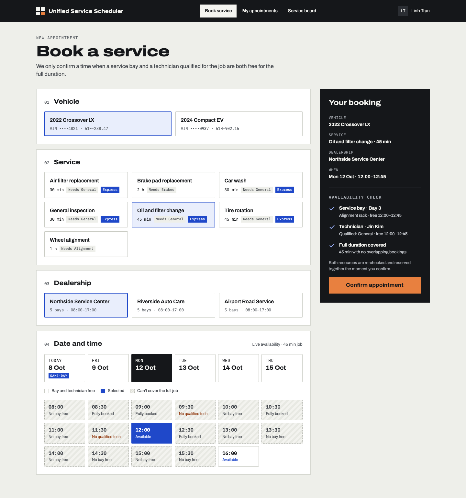
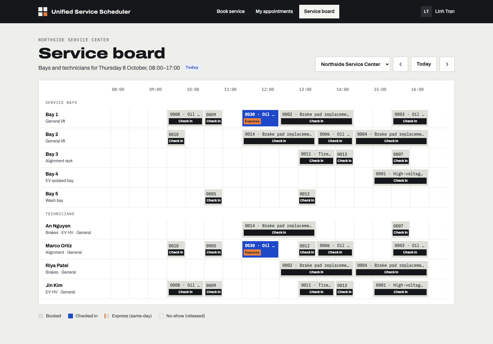
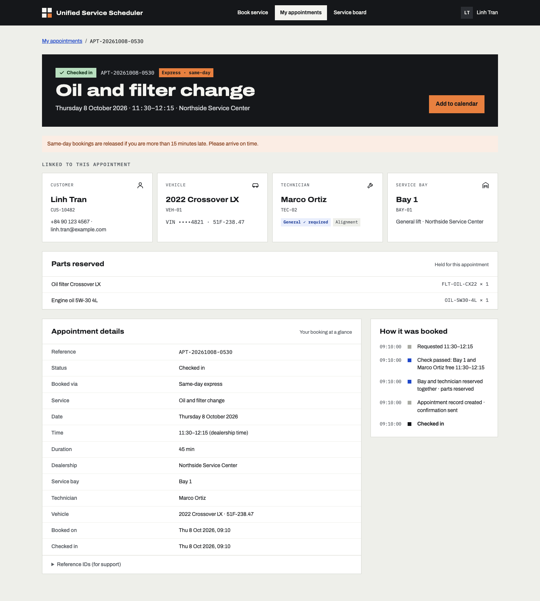
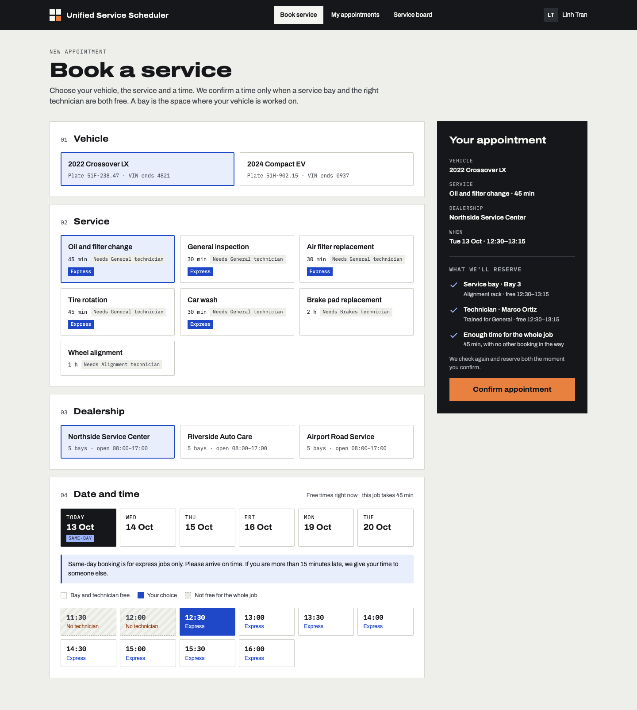
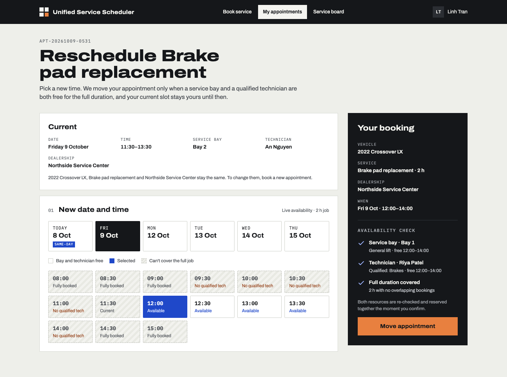
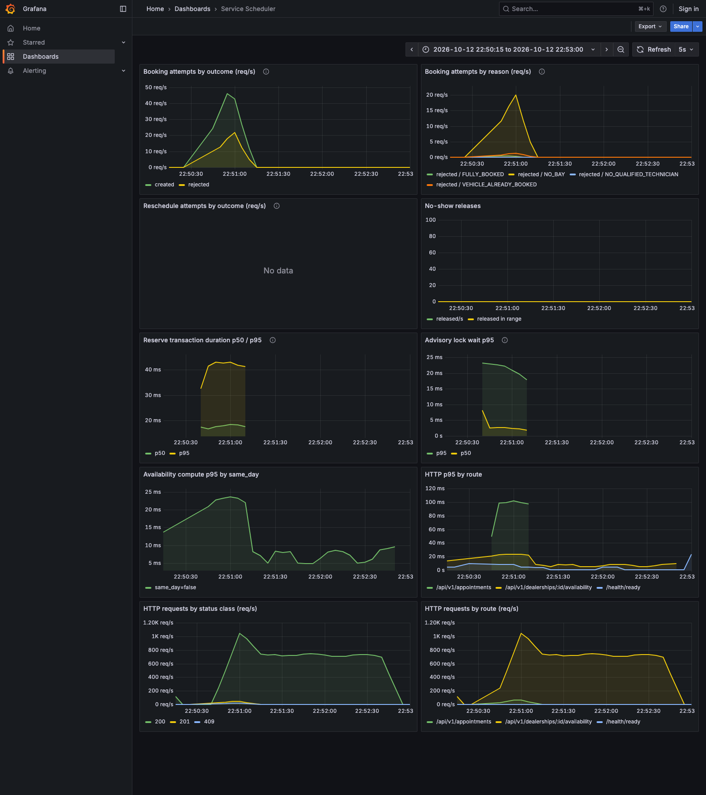

# Unified Service Scheduler

[](https://github.com/DuckHweeee/service-scheduler/actions/workflows/ci.yml)

Keyloop technical assessment — **Scenario A**. A service-appointment scheduler that confirms a booking **only** when a
suitable service bay **and** a technician qualified for the job are both free for the **entire** duration, and persists an
appointment linking customer, vehicle, technician and bay. Includes same-day "express" booking with lead time, capacity
quota, parts-in-stock check and late-arrival release, and rescheduling an appointment in place.

**Implemented layer: backend** (REST API + PostgreSQL, fully tested). The web app is a client harness built from the
provided UI design; it runs against the real API or against mocks.

### Evidence

Numbers from commands run on this commit (2026-10-12); each row links to the full output and method.

| | Result | Source |
|---|---|---|
| Tests | **339** unit + integration (contracts 23 · API unit 83 · API integration 181 on a real PostgreSQL · web 52) and **16** Playwright e2e on the real API, all passing | [quality.md](docs/quality.md#test-counts) |
| Coverage | availability engine **100%** statements / branches / functions / lines (enforced); API overall 94.58% statements, 90.85% branches (floor enforced) | [quality.md](docs/quality.md#coverage) |
| Mutation score | **98.77%** on `src/domain/**` (Stryker: 318 killed, 4 timeout, 3 survived, 1 no coverage — the 4 argued equivalent) | [quality.md](docs/quality.md#mutation-testing) |
| Concurrency | 20 parallel bookings for one free slot → exactly 1×201 and one row, also with the advisory lock removed; 20 parallel reschedules into one window → 1×200 (R11); the same appointment moved to two days at once → one winner (R15b) | [quality.md](docs/quality.md#reschedule-suites-wave-5) · [ADR-002](docs/adr/002-double-booking-prevention.md) · [ADR-006](docs/adr/006-reschedule-in-place.md) |
| Independent review | a lock-order deadlock (reschedule vs cancel / no-show sweeper → `40P01` → 500) missed by R1–R15b, found by an adversarial review agent, reproduced and fixed | [ai-log W5-Q2](docs/ai-log.md#wave-5--showcase-polish-2026-10-12) · [quality.md](docs/quality.md#manual-and-adversarial-checks) |
| Load test (k6, one API process) | 772 req/s with 0 failed requests; booking p95 100.9 ms, availability p95 13.0 ms; **0** invariant violations after 1,001 bookings | [performance.md](docs/performance.md) |

| | |
|---|---|
|  |  |
|  |  |
|  |  |

## Deliverables

| Deliverable | Where |
|---|---|
| System Design Document | [`docs/SYSTEM_DESIGN.md`](docs/SYSTEM_DESIGN.md) (architecture diagram, components, data flow, technology choices, observability, GenAI in design) |
| Detailed spec / contract | [`docs/SPEC.md`](docs/SPEC.md) · decisions in [`docs/adr/`](docs/adr/) |
| API contract | Swagger UI at `/docs` · [`docs/openapi.yaml`](docs/openapi.yaml) · [`docs/requests.http`](docs/requests.http) · [`docs/curl-examples.md`](docs/curl-examples.md) |
| Observability | [`docs/observability.md`](docs/observability.md) · Grafana dashboard in the Docker `obs` profile |
| Quality and performance evidence | [`docs/quality.md`](docs/quality.md) · [`docs/performance.md`](docs/performance.md) · [`loadtest/`](loadtest/README.md) |
| AI Collaboration Narrative | [below](#ai-collaboration-narrative) · full log [`docs/ai-log.md`](docs/ai-log.md) · agent prompts [`docs/agent-briefs/`](docs/agent-briefs/) |

## Prerequisites

- **Node.js 22+** and **pnpm 10** (`corepack enable` provides the pinned version).
- **No Docker required** for path A. PostgreSQL 18 runs from the [`embedded-postgres`](https://www.npmjs.com/package/embedded-postgres)
  npm package (binaries for macOS arm64/x64 and Linux). If you prefer Docker: `docker compose up -d postgres` exposes the
  same port and credentials.
- **Docker** (Compose v2) for path B: the whole stack in containers, plus Prometheus, Grafana and Jaeger.

## Build and run

### A. pnpm + embedded PostgreSQL (no Docker)

```bash
corepack enable
pnpm install

# terminal 1 — database (embedded PostgreSQL 18 on :54329, data in .pgdata/; Ctrl-C stops it)
pnpm db:up

# terminal 2 — schema + demo data, then API + web against the real API
pnpm db:migrate && pnpm db:seed
pnpm dev:real            # API http://localhost:3000 (Swagger: /docs, metrics: /metrics) · web http://localhost:5173
```

Other modes:

| Command | What it runs |
|---|---|
| `pnpm dev:mock` | Web only, on in-browser mocks (MSW) — no database needed. Scenario switches: `?mock=conflict`, `?mock=parts`, `?mock=cutoff`, `?mock=morning` |
| `pnpm dev` | API + web; web uses mocks unless `VITE_USE_MOCKS=false` |
| `CLOCK_OVERRIDE=2026-10-08T09:10:00+07:00 pnpm --filter @scheduler/api dev` | API with a pinned "now" — useful for demonstrating same-day rules at any time of day |
| `docker compose --profile obs up -d jaeger` + `OTEL_EXPORTER_OTLP_ENDPOINT=http://localhost:4318` | Traces in Jaeger at http://localhost:16686 |
| `pnpm --filter @scheduler/web build` | Production build of the web app |

Configuration is environment-only; see [`.env.example`](.env.example). Defaults work for local development.

### B. Docker Compose (app + observability)

```bash
docker compose --profile app up --build                    # postgres → migrate (+ seed when empty) → API :3000 → web :5173
docker compose --profile app --profile obs up -d --build   # + Grafana :3001, Prometheus :9090, Jaeger :16686
docker compose --profile app --profile obs down            # stop (add -v to drop the database volume)
```

- **Ports.** `pnpm db:up` (path A) and the compose `postgres` service both bind **:54329** — stop one, or move the
  container with `PG_PORT`. Other host ports: `API_PORT`, `WEB_PORT`, `GRAFANA_PORT`, `PROMETHEUS_PORT`; if you change
  `API_PORT` / `WEB_PORT`, also set `API_PUBLIC_URL` / `WEB_ORIGIN` (the browser-facing URLs baked into the web image and
  allowed by CORS).
- **Demo clock.** `CLOCK_OVERRIDE=2026-10-08T09:10:00+07:00 docker compose --profile app up -d` pins "now" for the
  migrate/seed and API containers (same caveat about the browser clock as below).
- **Reseed.** The `migrate` service seeds only an empty database; force it with
  `docker compose --profile app run --rm -e SEED=always migrate`.
- **Tracing** is off unless `OTEL_EXPORTER_OTLP_ENDPOINT=http://jaeger:4318` is set; compose head-samples 10% of traces
  by default (`OTEL_TRACES_SAMPLER_ARG=1` for all). Dashboard panels and sampling: [`docs/observability.md`](docs/observability.md#prometheus-and-grafana-docker).
- **Load test** (k6 in a container, then an invariant check in SQL): [`loadtest/README.md`](loadtest/README.md).

The seed is deterministic and relative to today: three dealerships (DLR-03 deliberately has no alignment-qualified
technician, DLR-02 is out of the Crossover oil filter for the parts demo), eight service types, the demo customer
**Linh Tran (CUS-10482)** with a 2022 Crossover LX (ICE) and a 2024 Compact EV, and ~30% background load for the next
ten working days.

## Test

```bash
pnpm verify              # typecheck + lint + all unit/integration tests (exit code is what CI uses)
pnpm --filter @scheduler/api test:unit     # pure engine + time + seed (fast)
pnpm --filter @scheduler/api test:int      # integration tests against a real, ephemeral PostgreSQL
pnpm e2e                 # Playwright: real API + real DB + web (see e2e/README.md)
pnpm coverage            # coverage with thresholds (engine 100%)
pnpm --filter @scheduler/api mutation      # Stryker mutation testing on src/domain/** (~20 s)
```

`pnpm e2e` uses Playwright's bundled Chromium (`pnpm exec playwright install chromium` once). On macOS 12, where that
Chromium is unsupported, point it at an installed Chrome:
`PW_CHROME_PATH="/Applications/Google Chrome.app/Contents/MacOS/Google Chrome" pnpm e2e`.

What the suites cover (339 unit/integration tests across contracts, API and web, plus 16 e2e tests; counts and
coverage in [`docs/quality.md`](docs/quality.md)):

- **Availability engine** — every rule in the spec's test table (T1–T21: full-duration overlap, back-to-back, skills, bay
  types, assignment preference, same-day lead time/quota/cutoff), property-based tests that re-derive every slot status
  independently, 100% line and branch coverage.
- **Booking under concurrency** — 20 parallel requests for one free slot → exactly one 201 and one row; capacity 2 → exactly
  two; same-day quota races; parts-stock races; concurrent idempotent retries; check-in vs no-show sweeper races.
- **Reschedule** — every SPEC §6.5 case by id (R1–R15, R15b): parts follow the channel, 20 parallel reschedules into
  one window, reschedule vs booking, crossing days without deadlock, the same appointment moved twice at once; plus a
  30-test independent adversarial suite (validation parity with booking, a grid ↔ reschedule golden check over every
  slot, forced races against cancel / check-in / sweeper).
- **Database invariants** — exclusion constraints reject overlapping technician / bay / vehicle bookings; composite foreign
  keys stop cross-dealership assignment; inventory can never be over-reserved.
- **API behaviour** — every endpoint and error code (problem+json), audit history wording, metrics.
- **Web** — component tests on mocks; e2e journeys (book → record → cancel; conflict → alternatives; same-day express;
  board check-in; book → reschedule) plus screenshots at 1440 and 390 px.

Integration tests never mock the database: a vitest global setup starts an ephemeral PostgreSQL on a random port and each
test file gets its own database cloned from a migrated template.

## API at a glance

| Method & path | Purpose |
|---|---|
| `GET /api/v1/dealerships/{id}/availability?serviceType&date&vehicleId[&excludeReference]` | Slot grid for a day: status per 30-min start + proposed bay/technician. `excludeReference=APT-…` computes the grid as if that appointment did not exist (reschedule screen); 422 `RESCHEDULE_SCOPE_MISMATCH` if it belongs to another dealership, service or vehicle |
| `POST /api/v1/appointments` (`Idempotency-Key` optional) | Book: 201, or 409 `SLOT_UNAVAILABLE` with `reason` and up to 5 alternatives. Same key + same request replays with 200; same key + different request is 422 `IDEMPOTENCY_KEY_REUSED` |
| `GET /api/v1/appointments/{reference}` | Appointment with customer, vehicle, technician, bay, parts and booking history |
| `GET /api/v1/appointments?customerId` | Customer's appointments |
| `POST /api/v1/appointments/{reference}/cancel` | Cancel and free resources; 409 `APPOINTMENT_NOT_CANCELLABLE` once started or checked in |
| `POST /api/v1/appointments/{reference}/reschedule` | Move to another date/time at the same dealership, in place (same reference): 200, or 409 `SLOT_UNAVAILABLE` (+ alternatives) / `VEHICLE_ALREADY_BOOKED` / `PARTS_UNAVAILABLE` / `APPOINTMENT_NOT_RESCHEDULABLE`, and the booking 422s. Same slot → 200, no change ([ADR-006](docs/adr/006-reschedule-in-place.md)) |
| `POST /api/v1/appointments/{reference}/check-in` | Advisor check-in; late same-day arrivals are released |
| `GET /api/v1/dealerships/{id}/board?date` | Day timeline per bay and technician |
| `GET/PUT /api/v1/dealerships/{id}/inventory[/{sku}]` | Parts stock (stands in for a DMS feed) |
| `GET /api/v1/dealerships`, `/service-types`, `/customers/{id}`, `/customers/{id}/vehicles` | Reference data |

Errors are RFC 7807 `application/problem+json` with a stable `code`; dates must be real calendar dates (`2026-11-31` is a 400 `VALIDATION_ERROR`). Full contract: `/docs` or
[`docs/openapi.yaml`](docs/openapi.yaml).

## How double booking is prevented

1. **Engine:** a window is bookable only if some bay of an allowed type **and** some technician with the required skill are
   free for the whole half-open interval `[start, end)`.
2. **Transaction:** the booking takes a PostgreSQL advisory lock for that dealership-day, re-reads the schedule inside the
   transaction and re-checks before inserting (correct reason, alternatives and same-day quota under contention).
3. **Database:** `EXCLUDE USING gist` constraints on `(technician_id, during)`, `(service_bay_id, during)` and
   `(vehicle_id, during)` for confirmed appointments make an overlap impossible even if (1) or (2) were wrong. Tested by
   removing the lock: still never double-books. See [ADR-002](docs/adr/002-double-booking-prevention.md).

Reschedule uses the same three layers: it locks both the old and the new dealership-day in a fixed order, re-checks the
new window as if the appointment were gone, and updates the row with a guarded `UPDATE` that the constraints still
check against every other booking ([ADR-006](docs/adr/006-reschedule-in-place.md), [System Design §4.3](docs/SYSTEM_DESIGN.md#43-rescheduling-write-path-adr-006)).

## Repository layout

```
packages/contracts   zod schemas, enums, URL paths, fixtures — shared by API and web
apps/api             Fastify API: routes → services → pure domain (availability engine, same-day policy, time)
  drizzle/           migrations (incl. hand-written EXCLUDE constraints)
  test/              unit + integration (real PostgreSQL)
  Dockerfile         API image (multi-arch, non-root, healthcheck)
apps/web             React app: Book, My appointments, Appointment record, Reschedule, Service board; MSW mocks
e2e/                 Playwright specs with their own DB/API/web stack
loadtest/            k6 script, load-data seed, SQL invariant check
ops/                 Prometheus config, provisioned Grafana dashboard, migrate/seed entrypoint for compose
design/              the original UI design bundle and the extracted screens
docs/                system design, spec, ADRs, quality + performance evidence, observability, API docs, AI log,
                     agent briefs, screenshots
```

## Known limitations

- No authentication: the web acts as customer CUS-10482; the service board is an unauthenticated advisor view.
- The web decides "today" from the browser clock in the dealership's timezone; with `CLOCK_OVERRIDE` on the API, use a
  browser clock that matches (the e2e suite pins both). Same-day panels themselves follow the server's answer.
- Check-in is not time-bounded: an advisor can check in an advance appointment on an earlier day (SPEC §6.3 does not
  restrict it). Reserved parts are released on cancel / no-show but never consumed on completion; stock is expected to
  be corrected by the DMS inventory sync.
- The availability grid does not mark slots where the customer's vehicle is already booked elsewhere; booking or
  rescheduling into one returns 409 `VEHICLE_ALREADY_BOOKED` (the 409 alternatives do skip them).
- Appointment references are `APT-<date>-<nextval % 10000>`: at scale (10,000+ bookings between two on the same date)
  two can collide; the unique constraint then rejects the second insert, which the API answers with a 500 (only `23P01`
  is mapped to 409). A per-date counter or a longer suffix would remove it.
- Reschedule keeps the dealership and service (another dealership or service is a cancel plus a new booking).
  Notifications are out of scope.
- Docker: tracing is head-sampled at 10% in compose by default (100% OOM-killed the in-memory Jaeger under load); the
  API image runs TypeScript through `tsx` (no compile step), which is simple but not a tuned production build.
- More in [System Design §10](docs/SYSTEM_DESIGN.md#10-future-work), including design sketches for authentication and
  technician shifts.

---

## AI Collaboration Narrative

> Draft prepared from the project log for Huy to review and edit in their own words before submission.

**Tools.** Claude Code with **Claude Opus** as design partner and orchestrator, and **Claude Sonnet** agents as
implementers, each running in an isolated git worktree. Every prompt given to an agent is archived verbatim in
[`docs/agent-briefs/`](docs/agent-briefs/); every review, defect and correction is dated in [`docs/ai-log.md`](docs/ai-log.md).

### Strategy: make the work well-scoped before any AI writes code

1. **Humans decide, AI frames.** Opus turned the open questions (which layer, stack, scope, timebox) into explicit options with
   a recommendation; I made the calls. I added the domain rules the brief did not have — the same-day express policy (express
   services only, lead time, capacity quota, parts in stock, late-arrival release) — and Opus turned them into testable rules.
2. **Spec and contracts first.** Before the first agent ran, Opus wrote what agents could not change: [`SPEC.md`](docs/SPEC.md)
   with a numbered test table (T1–T21), the shared zod contracts with fixtures that are themselves tested, the engine's type
   signatures, the router with one stub per endpoint, and ADRs.
3. **Small packages with exclusive file ownership.** Ten work packages in four waves (foundation · engine · web shell →
   read endpoints · booking · screens → observability · late-arrival · e2e · API docs/CI). Each brief lists the files the
   agent owns, what it may read, allowed dependencies, deliverables and acceptance criteria with evidence. Parallel agents
   never touched the same file, so merges were mechanical.
4. **Agents report, they don't self-certify.** Every agent ended with the same report format — acceptance criteria with
   evidence, assumptions, deviations — and was told to flag spec contradictions instead of bending tests.

### Verification: trust nothing that was not observed

- **Review every diff** against the spec before merging, and run the whole suite on `main` after each merge.
- **Mutation testing at each gate:** deliberately break the code (half-open overlap `<` → `<=`, drop the skill ranking,
  off-by-one in the quota, skip the window check, include cancelled rows on the board, make the grace period exclusive…) and
  require a test to go red. Every mutant was caught; the results are in the log.
- **Run the real thing**, not just tests: start the server, book, conflict, cancel over HTTP, read `/metrics`; drive the UI in
  a real browser and compare screenshots against the design at 1440 and 390 px.

### What the process caught (selected — details in the log)

| Found by | Problem | Outcome |
|---|---|---|
| Sonnet (engine) | A wrong expectation in Opus's own test table (T8) | Spec corrected after re-deriving by hand |
| Sonnet (API foundation) | pnpm 10 skipped the PostgreSQL package's install script → DB would not start on a fresh clone | Fixed in workspace config, verified with a clean reinstall |
| Sonnet (booking), via its own mutation check | Concurrent retries with the same idempotency key could get 409 instead of 200 | Fixed and covered by a test |
| Opus review | Booking history dropped the "Customer chose …" step shown in the design | Sent back with exact expected wording; fixed by the agent |
| Opus verification | **The test runner exited 0 even when tests failed** (an exit hook inside `embedded-postgres`) — every green build was unverified | Root-caused, fixed, proven with a deliberately failing run |
| Opus smoke test | Seed data made the default service (brake pads) unbookable on every day — no test covered it | Seed retuned; spec updated |
| Opus | Its own slips: pushing without the full suite, a `verify \| grep` that hid an exit code, a broken test rewrite | Logged; gate changed to `pnpm verify && git push` |
| Opus gate (W5-A8 reschedule) | The agent's own mutation "lock only the new day" left every test green: the old-day lock was untested (two moves of one appointment to different days → last writer wins) | Sent back; agent added R15b; lock removed → both R15b tests red |
| Sonnet (W5-Q2, independent review of code it did not write) | A lock-order deadlock: reschedule released parts before locking the appointment row, cancel / the no-show sweeper lock row then parts → `40P01` → 500. R1–R15b and every gate missed it | Opus reproduced it, fixed the lock order; removing the fix turns the new tests red |
| Permission rules | The project's deny rules on `SPEC.md` and contracts also blocked Opus | Opus did not route around them through the shell; Huy lifted them for the SPEC v0.3 edit |
| Opus integration run | e2e on the real API failed 3/16 after the reschedule merge | Test data, not the app (a slot overlapping the vehicle's earlier bookings; a checked-in first row); specs fixed, 16/16 green |

### How quality was ensured

Correctness lives in layers that are each tested on their own: a pure engine with property-based tests and full coverage;
database constraints proven by integration tests that try to violate them; a transaction design verified under real
concurrency and re-verified with the lock removed; and the user journeys covered end to end in a real browser. The AI wrote
most of the code; the decisions, the contracts it had to satisfy, and the evidence that it does were owned by us.
