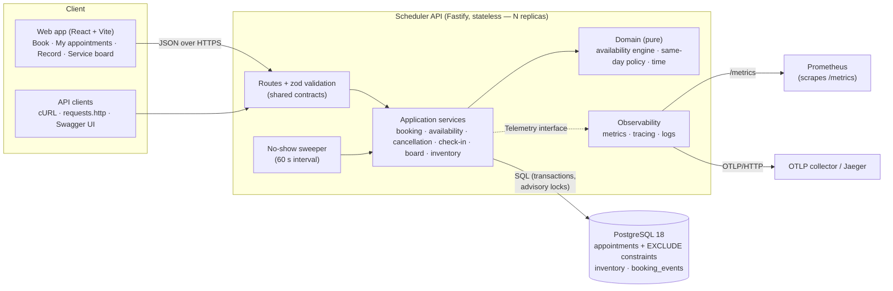
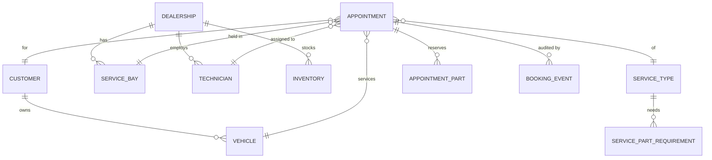

# Unified Service Scheduler — System Design

Keyloop technical assessment · **Scenario A** · Author: Mai Đức Huy (with Claude Opus as design partner and orchestrator,
Claude Sonnet agents as implementers).

**Problem.** Replace manual service booking with an application that accepts a request for a vehicle, service type,
dealership and time, and confirms it **only** if a suitable service bay **and** a technician qualified for that service are
both free for the **entire** job — then persists an appointment linking customer, vehicle, technician and bay.

**Implemented layer:** the backend, in full (REST API, PostgreSQL, tests, observability). The web app is built from the
provided UI design as a *client harness* for the API (ADR-001).

Contents: [1 Architecture](#1-architecture) · [2 Components](#2-components) · [3 Data model](#3-data-model) ·
[4 Data flow](#4-data-flow) · [5 Technology choices](#5-technology-choices) · [6 Scalability, performance, reliability](#6-scalability-performance-and-reliability) ·
[7 Observability](#7-observability) · [8 Assumptions](#8-assumptions) · [9 How GenAI was used in design](#9-how-genai-was-used-in-the-design-phase) ·
[10 Future work](#10-future-work)

---

## 1. Architecture



Rendered copies of the diagrams (for offline/PDF use): [`diagrams/`](diagrams/).

The repository is a TypeScript monorepo: `packages/contracts` (zod schemas shared by API and web), `apps/api`, `apps/web`.

## 2. Components

| Component | Role |
|---|---|
| **Contracts** (`packages/contracts`) | Single source of truth for request/response shapes, enums, error codes and URL paths. The API validates and serialises with them (and generates OpenAPI from them); the web parses responses with them. Contract drift is a compile error. |
| **Routes** (`apps/api/src/routes`) | Thin HTTP adapters: zod schemas for params/query/body/response, call one service, return a DTO. |
| **Availability engine** (`src/domain/availability`) | Pure functions, no I/O: given a dealership-day (bays, technicians, their busy intervals) and a service (duration, required skill, allowed bay types), computes every 30-minute start with a status (`AVAILABLE`, `NO_QUALIFIED_TECHNICIAN`, `NO_BAY`, `FULLY_BOOKED`, `SAME_DAY_QUOTA_REACHED`) and a proposed bay + technician; finds alternatives; evaluates the same-day policy. The heart of requirement 2. |
| **Day plan** (`src/services/day-plan.ts`) | Glue that resolves a request into engine input: entity lookups, powertrain applicability, booking horizon, same-day decision (lead time, quota, parts), and the `DayContext` loaded from the database. Shared by the availability read model and the booking command so both apply identical rules. |
| **Booking service** | The write path (§4.2): advisory lock → re-check inside the transaction → reserve parts → insert appointment + audit events → commit. Idempotency key support: the same key with the same request replays the original (200); with a different request it is refused (422 `IDEMPOTENCY_KEY_REUSED`). |
| **Cancellation / check-in / no-show sweeper** | State transitions guarded by `UPDATE … WHERE status = 'CONFIRMED'` (cancel also requires not checked in), releasing resources and parts; late same-day arrivals become `NO_SHOW`. |
| **Board / inventory / reference** | Read models for the advisor timeline, parts stock (standing in for a DMS stock feed) and reference data. |
| **PostgreSQL** | System of record. Exclusion constraints make overlapping confirmed bookings of the same technician, bay or vehicle **impossible** (ADR-002). `booking_events` is an append-only audit trail. |
| **Observability** | prom-client metrics, OpenTelemetry tracing, pino JSON logs with request and trace ids — behind a vendor-free `Telemetry` interface. |
| **Web app** | Implements the three designed screens plus My appointments; runs against MSW mocks (dev, tests) or the real API. |

## 3. Data model



Key invariants enforced **by the database**, not only by code:

- `EXCLUDE USING gist (technician_id WITH =, tstzrange(start_at, end_at, '[)') WITH &&) WHERE status = 'CONFIRMED'`
  — and the same for `service_bay_id` and `vehicle_id`. Half-open ranges allow back-to-back jobs.
- Composite foreign keys `(technician_id, dealership_id)` and `(service_bay_id, dealership_id)`: a resource can only be
  booked at its own dealership.
- `CHECK (reserved <= on_hand)` on inventory: parts can never be over-reserved.

Full DDL: [`SPEC.md` §4](SPEC.md#4-database-postgresql-18).

## 4. Data flow

### 4.1 Checking availability (read path)

1. The web calls `GET /dealerships/{id}/availability?serviceType&date&vehicleId`.
2. `resolveDayPlan` validates the request (400 for malformed or non-calendar dates, 404 / 422), decides whether it is a same-day request and, if so, evaluates the
   same-day policy (express-only service, lead time (a started minute counts as a full one) rounded up to the grid, parts in stock for this vehicle model, quota).
3. `loadDayContext` reads the dealership's bays, technicians and **confirmed** appointments for that local date and turns
   them into busy intervals in local minutes.
4. The engine returns each start time with a status and a proposed bay + technician (deterministic: least-specialised
   technician first, preferred bay type first — ADR-003). The response is a non-binding preview.

### 4.2 Booking (write path)

```mermaid
sequenceDiagram
  autonumber
  participant W as Web / client
  participant A as API (booking service)
  participant P as PostgreSQL
  W->>A: POST /appointments {vehicle, service, dealership, date, startTime, sessionId} + Idempotency-Key
  A->>A: validate (ownership, applicability, horizon, opening hours, grid, same-day lead time)
  A->>P: INSERT booking_event SLOT_REQUESTED
  A->>P: BEGIN, then pg_advisory_xact_lock(dealership, date)
  A->>P: re-read DayContext + parts + quota (inside the lock)
  A->>A: checkWindow — bay AND qualified technician free for the whole window?
  alt available
    A->>P: UPDATE inventory SET reserved = reserved + qty WHERE on_hand - reserved >= qty (same-day only)
    A->>P: INSERT appointment (+ parts) and events CHECK_PASSED, RESOURCES_RESERVED, APPOINTMENT_CREATED
    A->>P: COMMIT
    A-->>W: 201 AppointmentDetail
  else not available / parts short / vehicle busy
    A->>P: ROLLBACK
    A->>P: INSERT booking_event CHECK_FAILED (outside the rolled-back tx)
    A->>P: compute up to 5 alternatives (same day, then next working days; skips windows where the vehicle is booked)
    A-->>W: 409 problem+json {code, reason, alternatives}
  end
  Note over P: If application logic were ever wrong, the EXCLUDE constraints raise 23P01 → mapped to 409.
```

Why two layers (ADR-002): the **advisory lock** serialises bookings for one dealership-day, so the in-transaction re-check,
resource choice, same-day quota and the failure reason are correct; the **exclusion constraints** guarantee the
no-double-booking invariant even if the lock were removed (proven by a mutation test: 20 parallel requests for one free slot
→ exactly one 201 with or without the lock).

### 4.3 After booking

- **Cancel** (`POST /appointments/{ref}/cancel`): `CONFIRMED`, not yet started and not checked in → `CANCELLED`, parts released, event written (a checked-in or started appointment is 409 `APPOINTMENT_NOT_CANCELLABLE`); the window is
  immediately bookable again because the constraints only cover `CONFIRMED` rows.
- **Check-in** (advisor, from the board): records arrival; a same-day booking more than 15 minutes late becomes `NO_SHOW`.
  A 60-second **sweeper** applies the same rule to bookings nobody checked in.
- **History**: `GET /appointments/{ref}` returns the appointment with its linked customer, vehicle, technician and bay, plus
  the audit trail rendered as sentences ("Check failed: no Brakes-qualified technician free for the full window. Five
  alternatives offered.").

## 5. Technology choices

| Choice | Why |
|---|---|
| **TypeScript end-to-end** | One language and one type system across API, web and the shared contracts; the contracts package turns API/web drift into compile errors. |
| **Fastify 5 + fastify-type-provider-zod** | Fast, schema-first HTTP framework; zod schemas validate requests, serialise responses and generate OpenAPI from the same definitions. |
| **PostgreSQL 18** | Transactions, `tstzrange` + `btree_gist` exclusion constraints (the cleanest way to make overlapping bookings impossible), advisory locks, `timestamptz`. |
| **Drizzle ORM** | Typed SQL close to the metal; hand-written SQL migration for what an ORM cannot express (`EXCLUDE`). |
| **Luxon** | IANA timezone arithmetic, confined to one module (`domain/time.ts`); the engine itself works in integer local minutes (ADR-004). |
| **Vitest + embedded-postgres** | Unit tests for the pure engine (incl. property-based tests with fast-check) and integration tests against a **real** PostgreSQL started per test run — no Docker required, no mocked database. |
| **prom-client + OpenTelemetry + pino** | Open standards: Prometheus metrics, OTLP traces to any backend (Jaeger locally), structured JSON logs. |
| **React 19 + Vite + TanStack Query + MSW** | Fast build, cache-aware data fetching with precise invalidation after bookings/cancellations, and API mocks so the UI could be built in parallel with the backend. |
| **Playwright** | End-to-end tests of the user journeys against the real API and database. |

## 6. Scalability, performance and reliability

- **Stateless API** → scale horizontally behind a load balancer. All coordination is in PostgreSQL.
- **Lock granularity = one dealership-day.** Contention exists only between customers competing for the same dealership and
  date; dealerships never block each other. `booking_lock_wait_seconds` makes contention visible.
- **Read/write split:** availability is a read model computed per request from indexed data
  (`appointments (dealership_id, start_at)`); at higher scale it can be served from read replicas or cached per
  dealership-day with invalidation on booking events.
- **Partitioning path:** appointments partition naturally by dealership (and by date); the lock key already follows that shape.
- **Idempotency:** `Idempotency-Key` makes client retries after timeouts safe (verified under concurrency). A key reused for a different request is rejected (422) rather than replayed, so it can never return someone else's appointment.
- **Failure isolation:** failed attempts are recorded outside the rolled-back transaction, so the audit trail survives
  failures; `/health/ready` checks the database for orchestrator readiness probes.
- **Correctness under concurrency is tested**, not assumed: 20-way races for one slot, same-day quota races, parts races,
  concurrent cancels, check-in vs sweeper races.

## 7. Observability

Detailed in [`observability.md`](observability.md).

- **Metrics** (`/metrics`): `booking_attempts_total{outcome,reason,channel}` answers "is booking healthy and why does it
  fail?"; `booking_reserve_duration_seconds` and `booking_lock_wait_seconds` separate slow queries from contention;
  `http_request_duration_seconds{route}` uses route patterns to bound cardinality; `no_show_released_total`.
- **Tracing**: OpenTelemetry (HTTP, Fastify, pg auto-instrumentation) plus manual `booking.reserve` and
  `availability.compute` spans with dealership / service / channel / outcome attributes and no customer PII. Exported over
  OTLP only when configured.
- **Logs**: pino JSON with `reqId` (honours incoming `x-request-id`), `trace_id`/`span_id`, and one structured
  `booking attempt` line per booking.
- **Business audit**: `booking_events` records every request, check result, reservation, cancellation, check-in and no-show.
- **Suggested alerts**: booking success rate drop, lock-wait p95, 5xx ratio.

## 8. Assumptions

Documented in full in [`SPEC.md` §2](SPEC.md#2-assumptions--decisions-copy-into-the-system-design-document). Highlights:

- No authentication in scope; the web acts as one customer, and the service board is an advisor view.
- Dealership-local time everywhere (IANA timezone per dealership); 08:00–17:00, Mon–Fri; 30-minute grid; a job must finish
  within opening hours; back-to-back jobs allowed; technicians work all opening hours.
- The system assigns the bay and the technician; the customer chooses the time.
- Booking horizon: today to today + 30 days. Every booking is auto-confirmed.
- **Same-day booking** (product-owner rules, ADR-005): express services only (oil change, inspection, air filter, tire
  rotation, car wash); minimum 2-hour lead time; at most 20% of capacity for same-day jobs; only if the vehicle-specific parts
  are in stock (reserved atomically); late arrivals (> 15 min) are released.
- A service only applies to compatible vehicles (no oil change for an EV).

## 9. How GenAI was used in the design phase

The design was produced in a conversation between the author and **Claude Opus**, which then orchestrated **Claude Sonnet**
agents for implementation. The full, dated record is in [`ai-log.md`](ai-log.md); every agent prompt is archived verbatim in
[`agent-briefs/`](agent-briefs/).

1. **Extracting requirements from the design artefact.** The UI design came as a bundled HTML file. Opus unpacked it (a
   gzip + base64 manifest), read the three screens and their mock JavaScript, and derived the domain model from it: services
   carry a required skill and allowed bay types, technicians have skill sets, a 08:00–17:00 day on a 30-minute grid,
   UTC+7 timestamps. That became the first draft of the spec.
2. **Decisions kept with the human.** Opus framed the choices that change everything — which layer to implement, stack,
   scope, timebox — as explicit options with a recommendation; the author chose. The author then contributed the same-day
   express policy from domain knowledge (lead time, quota, parts, late arrivals), which Opus turned into testable rules
   (SPEC §5.4, ADR-005).
3. **Spec-first, contract-first.** Before any agent wrote code, Opus wrote the contract that agents could not change: the
   SPEC with a numbered test table (T1–T21), the zod contracts with fixtures validated by tests, the engine's type
   signatures, the router with stubs, and an exclusive file-ownership map so parallel agents never edited the same file.
4. **De-risking with experiments, not assumptions.** The dev machine had no Docker; before committing to PostgreSQL
   exclusion constraints, Opus verified that an embedded PostgreSQL binary starts, loads `btree_gist` and rejects an
   overlapping range with `23P01`.
5. **AI output was reviewed, and reviewing AI also caught the AI.** Agents found two defects in Opus's own design artefacts
   (a wrong expectation in test case T8; a pnpm setting that would have prevented PostgreSQL from starting on a fresh
   clone). Opus's verification found defects the agents missed: the test runner exited 0 on failing tests (an exit hook in a
   dependency), and the seed data made the default service unbookable. Each is described with evidence in `ai-log.md`.

## 10. Future work

Authentication and roles (customer vs advisor); reschedule; notifications (the confirmation copy promises a reminder);
technician shifts, breaks and absences; buffers between jobs; multi-day jobs; walk-in queue; live DMS integration for
inventory and customer/vehicle master data; a smarter assignment optimiser (look-ahead to maximise remaining capacity) behind
the same engine interface; a storage-level same-day quota counter (ADR-002 note); caching the availability read model per
dealership-day; marking vehicle-already-booked slots in the availability grid (today only the 409 alternatives skip them);
consuming reserved parts on completion; bounding check-in to the appointment day.
